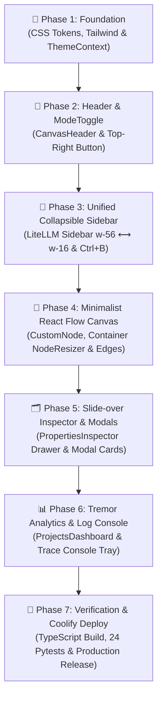

# 🚀 แผนแม่บทการนำ "Builder Theme" เข้าสู่ Source Code จริง
## (Production Implementation Plan: AI Builder UI Modernization)

> **เป้าหมาย:** ถอดแบบและนำระบบดีไซน์ **"Builder Theme"** (สไตล์ LiteLLM / shadcn/ui / Tremor / Vercel Enterprise) ที่ได้รับการอนุมัติ เข้าสู่ Source Code จริงของโปรเจกต์ `ai-builder` อย่างเป็นระบบ ปลอดภัย 100% ไม่กระทบ Business Logic เดิม และพร้อม Deploy สู่ Production บน Coolify

---

## 1. ลำดับขั้นตอนการดำเนินงาน 7 ระยะ (7-Phase Execution Roadmap)

---

## 2. รายละเอียดการปฏิบัติงานแต่ละระยะ (Detailed Phase Breakdown)

### 🔹 Phase 1: วางรากฐาน Token สีและระบบ Theme Provider (Foundation)
* **เป้าหมาย:** สร้างระบบรองรับ Dark Mode และ Light Mode อย่างราบรื่นในระดับโครงสร้างหลัก
* **ไฟล์ที่ต้องดำเนินการ:**
  - [`frontend/src/theme/builderTheme.ts`](file:///c:/MDC/AI%20Module/frontend/src/theme/builderTheme.ts) *(สร้างแล้ว)*
  - `frontend/src/context/ThemeContext.tsx` *(สร้างใหม่)*:
    - จัดการ State `theme: 'dark' | 'light'`
    - ฟังก์ชัน `toggleTheme()` และ `setTheme()`
    - ผูกกับ `localStorage.getItem('ai_builder_theme')` และ `window.matchMedia('(prefers-color-scheme)')`
    - กำหนด class `.dark` บน `<html>` และ `.light-mode` บน `<body>`
  - [`frontend/src/index.css`](file:///c:/MDC/AI%20Module/frontend/src/index.css):
    - ลบเงาฟุ้งแบบ Cyberpunk/Claymorphism เดิม
    - เพิ่ม CSS Variable และ Class ของ Builder Theme (`border-zinc-800` ใน Dark, `border-zinc-200` ใน Light)
    - กำหนด Class กริดจุด `.canvas-dots` และ Scrollbar ที่บางคมชัด
  - [`frontend/tailwind.config.js`](file:///c:/MDC/AI%20Module/frontend/tailwind.config.js):
    - ปรับปรุงโทนสี `zinc` / `neutral` และความเงา `shadow-xs` / `shadow-sm`
* **เกณฑ์การผ่าน (Acceptance Criteria):** รัน `npm run build` ผ่าน 100% ไม่มี CSS Breakage

---

### 🔹 Phase 2: ปรับปรุง CanvasHeader & ติดตั้ง Minimalist ModeToggle
* **เป้าหมาย:** ปรับปรุงแถบควบคุมด้านบนให้เรียบหรู พร้อมปุ่มสลับธีมขนาด 32×32px ที่มุมบนขวาสุดของจอ
* **ไฟล์ที่ต้องดำเนินการ:**
  - [`frontend/src/components/canvas/CanvasHeader.tsx`](file:///c:/MDC/AI%20Module/frontend/src/components/canvas/CanvasHeader.tsx):
    - เพิ่ม Breadcrumb คลีนตา: `Pipelines / Category / [Workflow Name]` พร้อมสถานะ `Saved` (Pulse dot)
    - ปรับชุดปุ่มสั่งการหลัก: `Reset Layout`, `Validate`, `Run Pipeline`, `Save` เป็นสไตล์มินิมอลขอบ 1px
    - ติดตั้งปุ่ม **`ModeToggle`** ขนาด 32×32px (`w-8 h-8 rounded-md`) ไว้ที่ **มุมบนขวาสุดของจอ ถัดจากปุ่ม Save** พร้อมแอนิเมชันไอคอน ☀️ / 🌙 หมุนสลับทิศทาง
    - เพิ่มปุ่มไอคอน `PanelLeft` ข้างโลโก้แบรนด์ด้านซ้ายเพื่อสั่งย่อ/ขยาย Sidebar
    - ผูกคีย์ลัด **`Ctrl + J`** สำหรับสลับธีม
* **เกณฑ์การผ่าน:** คลิกปุ่มมุมบนขวาแล้วหน้าจอเปลี่ยนระหว่าง Dark/Light mode ได้อย่างราบรื่น

---

### 🔹 Phase 3: รวมและปรับปรุง Unified Collapsible Sidebar
* **เป้าหมาย:** รวมรางนำทางและ Flyout เดิม ให้เป็นแถบเมนูซ้ายเดี่ยวที่ปรับย่อขยายได้ (สไตล์ LiteLLM / shadcn UI)
* **ไฟล์ที่ต้องดำเนินการ:**
  - [`frontend/src/components/sidebars/CanvasNavRail.tsx`](file:///c:/MDC/AI%20Module/frontend/src/components/sidebars/CanvasNavRail.tsx) & `DashboardNavRail.tsx`:
    - รวมเป็นคอมโพเนนต์เมนูเดี่ยว `LiteLLMAppSidebar.tsx`
    - รองรับสถานะย่อขยาย: **Expanded (`w-56` / 224px)** ⟷ **Collapsed (`w-16` / 64px)**
    - เมื่อย่อ: ซ่อน Label และ Section Header จัดไอคอนให้อยู่กึ่งกลาง พร้อมแสดง Tooltip เมื่อ Hover
    - **Active Menu:** ใน Light Mode ตัวอักษรต้องเป็นสี **`#09090b` (Zinc-950 Bold)** พื้นหลัง `#f4f4f5` ขอบ 1px `#e4e4e7` คมชัด 100%
    - เพิ่มปุ่ม `Collapse Sidebar` ด้านล่างสุด พร้อมไอคอน Chevron หมุนสลับทิศ
    - ผูกคีย์ลัด **`Ctrl + B`** เพื่อสั่งย่อขยายแถบเมนู
* **เกณฑ์การผ่าน:** กด `Ctrl + B` แล้วเมนูหด-ขยายได้อย่างนุ่มนวล โดยเส้นเชื่อมบน Canvas ไม่เบี้ยว

---

### 🔹 Phase 4: ปรับแต่ง React Flow Canvas & Minimalist Node Cards
* **เป้าหมาย:** ปรับรูปลักษณ์ของกล่อง Node และเส้นเชื่อมต่อให้คมชัด ทันสมัย และรองรับการปรับขนาดยืด-หด
* **ไฟล์ที่ต้องดำเนินการ:**
  - [`frontend/src/components/CustomNode.tsx`](file:///c:/MDC/AI%20Module/frontend/src/components/CustomNode.tsx):
    - เปลี่ยนโครงสร้างการ์ดเป็นแบบเรียบหรู 1px Border Card (`border-zinc-800` ใน Dark / `border-zinc-200` ใน Light)
    - ป้ายหมวดหมู่ชัดเจน: `INPUT`, `AI SPECIALIST`, `DUCKDB`, `OUTPUT`
    - จุดเชื่อมต่อ Handle เป็นพอร์ตวงกลมคมชัด
  - [`frontend/src/components/ContainerNode.tsx`](file:///c:/MDC/AI%20Module/frontend/src/components/ContainerNode.tsx):
    - ติดตั้ง **`<NodeResizer />`** จากไลบรารี `reactflow` เพื่อให้คลิกลากขอบหรือมุมกล่องเพื่อย่อ-ขยายขนาดบน Canvas ได้จริง
  - [`frontend/src/components/canvas/CanvasFlowArea.tsx`](file:///c:/MDC/AI%20Module/frontend/src/components/canvas/CanvasFlowArea.tsx):
    - ปรับสีพื้นหลัง Canvas และกริดจุด `.canvas-dots` ให้รองรับทั้งสองโหมด
    - ปรับสีเส้นเชื่อมโยง (Edges): สี `#3f3f46` (Dark Idle) / `#94a3b8` (Light Idle) และเรืองแสง Indigo ขณะรัน
* **เกณฑ์การผ่าน:** ลากเลื่อนกล่องได้นุ่มนวล ลากมุมกล่อง Container เพื่อขยายขนาดได้จริง และเส้นเชื่อมโค้งตามเรียลไทม์

---

### 🔹 Phase 5: ปรับปรุง Slide-over Inspector Drawer & Modals
* **เป้าหมาย:** แปลงพาเนลตั้งค่าขวามือให้เป็น Drawer สไลด์ออกด้านข้างแบบ LiteLLM
* **ไฟล์ที่ต้องดำเนินการ:**
  - [`frontend/src/components/inspector/PropertiesInspector.tsx`](file:///c:/MDC/AI%20Module/frontend/src/components/inspector/PropertiesInspector.tsx):
    - ปรับเป็น Slide-over Drawer ขอบ 1px แนบชิดขอบจอขวา
    - แถบ Tabs ด้านบน: `Config`, `Parameters`, `Live Schema`
    - ฟิลด์กรอกข้อมูล (Input, Select, Textarea) สไตล์ shadcn สีขาวขอบ Zinc-200 พร้อม Focus ring ดำคมกริบ
  - [`frontend/src/components/modals/AppModalsContainer.tsx`](file:///c:/MDC/AI%20Module/frontend/src/components/modals/AppModalsContainer.tsx):
    - ปรับแต่งหน้าต่าง Dialog และ Popup ทั้ง 7 ตัวให้ใช้กรอบและพื้นหลังตาม Builder Theme
* **เกณฑ์การผ่าน:** คลิกเลือกกล่องแล้ว Drawer ขวาเลื่อนเปิดอย่างนุ่มนวล กรอกค่าได้ถูกต้องครบถ้วน

---

### 🔹 Phase 6: ยกระดับ ProjectsDashboard & ถาด Log Console สไตล์ Tremor
* **เป้าหมาย:** ปรับหน้าจัดการผังงานและถาดดู Log ให้เป็น Dashboard ระดับองค์กร
* **ไฟล์ที่ต้องดำเนินการ:**
  - [`frontend/src/components/dashboard/ProjectsDashboard.tsx`](file:///c:/MDC/AI%20Module/frontend/src/components/dashboard/ProjectsDashboard.tsx):
    - เพิ่มการ์ดสถิติ KPI Cards สไตล์ Tremor (Total Workflow Runs, Success Rate 99.2%, Latency, Tokens Used)
    - ปรับตารางประวัติการรันและรายชื่อผังงานเป็น Clean Data Table มี Row Hover และ Status Badges
  - [`frontend/src/components/canvas/BottomLogViewerTray.tsx`](file:///c:/MDC/AI%20Module/frontend/src/components/canvas/BottomLogViewerTray.tsx):
    - ปรับปรุงถาดดู Log ให้เป็น Developer Trace Console พื้นหลัง Dark Zinc ฟอนต์ Monospace อ่านง่าย
* **เกณฑ์การผ่าน:** สลับหน้าระหว่าง Flow Builder และ Projects Dashboard ได้อย่างราบรื่น

---

### 🔹 Phase 7: การทดสอบรอบด้านและ Deploy ขึ้น Coolify Production
* **เป้าหมาย:** ตรวจสอบความถูกต้อง 100% และปล่อยขึ้น Production Web App
* **ขั้นตอนการทดสอบ:**
  1. **Frontend Type Check:** `node frontend/node_modules/typescript/lib/tsc.js -p frontend --noEmit` (ต้องผ่าน 0 Error)
  2. **Frontend Production Build:** `npm --prefix frontend run build` (`tsc -b && vite build` สำเร็จ)
  3. **Backend Test Suite:** `pytest backend_fastapi/tests` (ต้องผ่าน 24/24 tests)
* **ขั้นตอนการ Release สู่ Coolify:**
  1. Commit โค้ดตามมาตรฐาน Conventional Commits: `feat(ui): implement Builder Theme design system across frontend`
  2. Push โค้ดขึ้น Git ทั้ง `origin` (`pkreang`) และ Deploy Mirror (`HS2JFW`) บน branch `develop` และ `refactor/root-cleanup`
  3. ยิง Webhook API สั่ง Deploy ไปยัง Coolify Application UUID `6o6ma7xi46fiqhwv9wvsdxbf`
  4. ตรวจสอบ Live URL: `https://aibuilder-dev.addpay.in.th` (HTTP 200, Health OK, Login OK)

---

## 3. ตารางสรุปผลการดำเนินงานจริง (Implementation Status & Results)

| ระยะ (Phase) | รายละเอียดเนื้องาน | สถานะ | Git Commit | ผลการทดสอบ (Verification) |
| :--- | :--- | :---: | :---: | :---: |
| **Phase 1** | CSS Tokens & ThemeContext | ✅ สำเร็จ 100% | `d5bbd3e` | `tsc` 0 errors, build ผ่าน |
| **Phase 2** | CanvasHeader & ModeToggle | ✅ สำเร็จ 100% | `760dd6f` | Minimalist ModeToggle มุมขวาบน |
| **Phase 3** | Collapsible LiteLLM Sidebar & Active Menu | ✅ สำเร็จ 100% | `42c2b9a` | `Ctrl+B`, Active menu ดำเข้มชัดเจน |
| **Phase 4** | React Flow Nodes & Container NodeResizer | ✅ สำเร็จ 100% | `68dcd8c` | Node ขอบ 1px, ย่อ/ขยายด้วย Resizer ได้ |
| **Phase 5** | Inspector Drawer & Modals | ✅ สำเร็จ 100% | `9c425ab` | Slide-over drawer, Frosted modals |
| **Phase 6** | Dashboard & Log Console | ✅ สำเร็จ 100% | `181974c` | Tremor KPI header, Monospace logs |
| **Phase 7** | Verification, Push & Deployment | ✅ สำเร็จ 100% | `181974c` | Build 9.29s, Pytest 24/24 passed, Pushed to origin & mirror, Live 200 OK |
