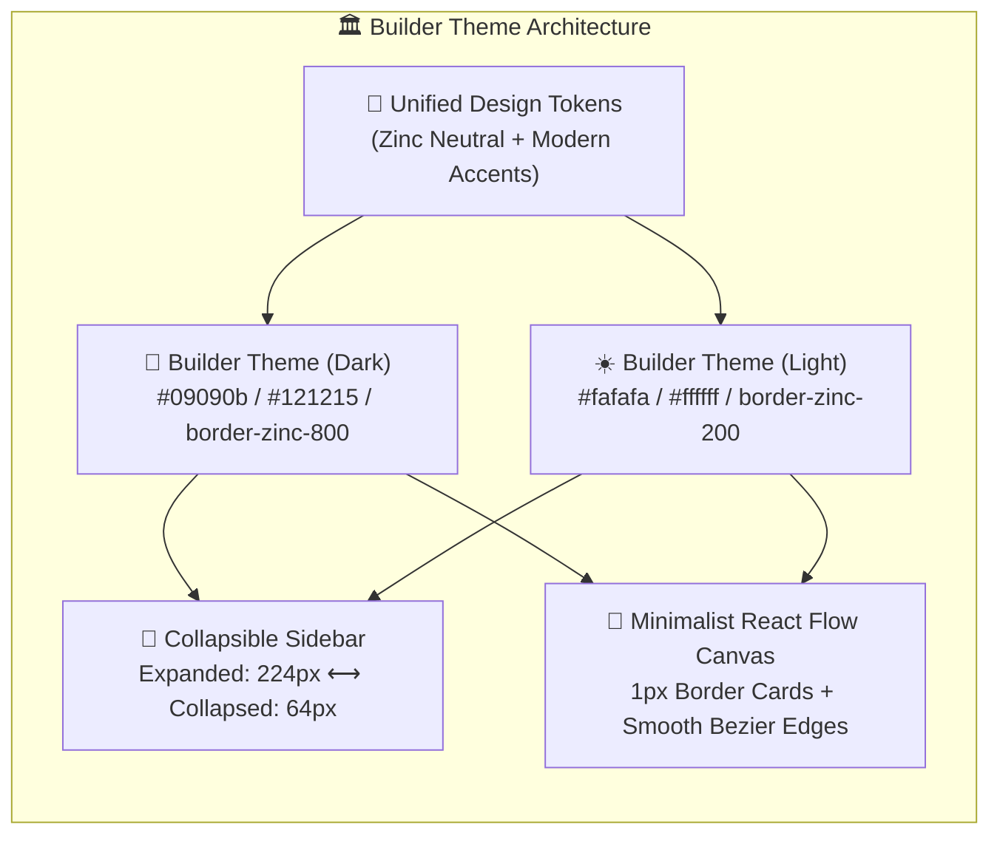

# 🏛️ ข้อกำหนดระบบดีไซน์ "Builder Theme" (Official Design System Specification)

> **ชื่อธีมอย่างเป็นทางการ:** **Builder Theme**  
> **สถานะ:** ได้รับการรับรองและบันทึกเป็นธีมมาตรฐานสำหรับโครงการ **AI Builder**  
> **แรงบันดาลใจหลัก:** **LiteLLM Admin UI**, **shadcn/ui**, **Tremor**, และ **Vercel Enterprise**

---

## 1. วิสัยทัศน์และการออกแบบ (Design DNA)

**Builder Theme** ถูกสร้างขึ้นเพื่อยกระดับระบบ **AI Builder** ให้เป็นแพลตฟอร์มบริหารจัดการโมเดลและผังงาน AI ในระดับองค์กร (Enterprise AI Platform) โดยเน้นความคมชัด ความเรียบหรู และความกระชับของข้อมูล (High Information Density) ปราศจากแสงฟุ้งที่รบกวนสายตา



---

## 2. ตารางเทียบชุดสีและโทเคน (Color Tokens Specification)

| องค์ประกอบ (UI Component) | Builder Theme (Dark Mode) | Builder Theme (Light Mode) | หมายเหตุ |
| :--- | :--- | :--- | :--- |
| **Canvas Background** | `#09090b` (`zinc-950`) | `#fafafa` (`zinc-50`) | พื้นหลังผังงาน ไม่สะท้อนแสง |
| **Canvas Dot Grid** | `#27272a` (`zinc-800`) | `#d4d4d8` (`zinc-300`) | จุดกริด 1.1px ระยะห่าง 24px |
| **Top Header Bar** | `#121215` (border: `zinc-800`) | `#ffffff` (border: `#e4e4e7`) | แถบนำทางด้านบน ความสูง 56px |
| **Left Navigation Sidebar** | `#101014` (border: `zinc-800`) | `#ffffff` (border: `#e4e4e7`) | แถบเมนูด้านซ้าย |
| **Active Menu Item** | `bg-indigo-500/15`, text `#ffffff` | `bg-zinc-100`, text **`#09090b` (Bold)** | คอนทราสต์ระดับ WCAG AAA |
| **Inactive Menu Item** | `text-zinc-400`, hover `text-white` | `text-zinc-600`, hover `text-black` | อ่านง่าย สบายตา |
| **React Flow Node Card** | `#141418` (border: `zinc-800`) | `#ffffff` (border: `#e4e4e7`) | การ์ดกล่องมน 12px เงา `shadow-xs` |
| **Node Drag Header** | `#18181b` (border: `zinc-800/80`) | `#fafafa` (border: `#f4f4f5`) | แถบจับลากของกล่อง |
| **Connecting Edges (Idle)** | `#3f3f46` (Stroke: 2.5px) | `#94a3b8` (Stroke: 2.5px) | เส้นเชื่อมโยงระหว่างกล่อง |
| **Connecting Edges (Active)** | `#6366f1` (Vibrant Indigo Flow) | `#4f46e5` (Deep Indigo Flow) | แอนิเมชันวิ่งตอนประมวลผล |
| **Primary Text** | `#f4f4f5` (`zinc-100`) | `#09090b` (`zinc-950` คมกริบ) | หัวข้อและข้อความสำคัญ |
| **Secondary / Meta Text** | `#a1a1aa` (`zinc-400`) | `#71717a` (`zinc-500`) | คำอธิบายและป้ายกำกับ |
| **Inspector Drawer** | `#121215` (border: `zinc-800`) | `#ffffff` (border: `#e4e4e7`) | พาเนลตั้งค่าขวามือ |
| **Logs Console Tray** | `#09090b` (Console dark) | `#ffffff` (Console: `#fafafa`) | ถาดดู Log ด้านล่าง |
| **Analytics Cards (Tremor)** | `#121215` (border: `zinc-800`) | `#ffffff` (border: `#e4e4e7`) | การ์ดสถิติ KPI และตารางประวัติ |

---

## 3. สถาปัตยกรรมแถบเมนูแบบย่อ-ขยาย (Collapsible Sidebar)

ตามมาตรฐาน **LiteLLM / shadcn UI Sidebar**:

```
[ โหมดปกติ (Expanded: w-56 / 224px) ]           [ โหมดย่อเล็ก (Collapsed: w-16 / 64px) ]
+-----------------------------------+           +----------+
| [AI Builder v3.0]                 |           | [AI]     |
|                                   |           |          |
| PLATFORM                          |           |          |
| 📊 Analytics & Stats              |   ===>    |   [📊]   |  <-- Hover เพื่อดู Tooltip
| 🔀 Flow Builder (Active)          |           |   [🔀]   |  <-- ไอคอนกึ่งกลาง คมชัด
| 📁 Workflows & Folders            |           |   [📁]   |
|                                   |           |          |
| AI & DATA                         |           |          |
| 🤖 AI Models & Routing            |           |   [🤖]   |
| 📦 Queues & Lakehouse             |           |   [📦]   |
| 📜 Execution Logs                 |           |   [📜]   |
|                                   |           |          |
| ADMINISTRATION                    |           |          |
| 👥 Access & Roles (RBAC)          |           |   [👥]   |
| ⚙️ Settings                       |           |   [⚙️]   |
|                                   |           |          |
| [<] Collapse Sidebar              |           |   [>]    |
| [U1] user01 (Superadmin)          |           |   [U1]   |  <-- เฉพาะ Avatar
+-----------------------------------+           +----------+
```

* **Transition:** `transition: width 0.25s cubic-bezier(0.4, 0, 0.2, 1)`
* **จุดควบคุม (Triggers):**
  1. ปุ่ม `PanelLeft` ข้างโลโก้บน Header
  2. ปุ่ม `Collapse Sidebar` ด้านล่างซ้าย
  3. คีย์ลัด **`Ctrl + B`** (หรือ `Cmd + B`)
* **State Persistence:** บันทึกสถานะอัตโนมัติที่ `localStorage.getItem('ai_builder_sidebar_collapsed')`

---

## 4. แถบควบคุมด้านบนและปุ่มสลับธีม (Minimalist ModeToggle)

จัดวางปุ่มเปลี่ยนโหมดธีมไว้ที่ **มุมบนขวาสุดของจอ** ถัดจากปุ่ม `Save` โดยแยกด้วยเส้นแบ่ง 1px:

```
+---------------------------------------------------------------------------------------------------------+
| [AI Builder]  Breadcrumb: Pipelines / Finance / Invoice Flow     (Saved)                                 |
|                                         [Reset Layout] [Validate] [Run Pipeline] [Save]  |  [ ☀️ / 🌙 ]  |  <-- ขวาสุดของจอ
+-----------+-------------------------------------------------------------------------------+-------------+
```

* **Component:** `ModeToggle` (32×32px `w-8 h-8 rounded-md`) พร้อมแอนิเมชันหมุนสลับไอคอน
* **คีย์ลัดสลับธีม:** **`Ctrl + J`** (หรือ `Cmd + J`)
* **State Persistence:** บันทึกสถานะอัตโนมัติที่ `localStorage.getItem('ai_builder_theme')` (`'dark' | 'light'`)

---

## 5. การ์ดโหนดบน Canvas (Minimalist Flow Nodes)

* **ประเภทและป้ายกำกับ (Badges):**
  - `INPUT` (PDF/Data Ingestion): เทา-กลาง (`zinc-700` / `zinc-200`)
  - `AI SPECIALIST` (Gemini, Claude, GPT): ม่วงอ่อน-คราม (`indigo` / `violet`)
  - `DUCKDB` (Lakehouse & Analytics Engine): เหลืองอำพัน (`amber`)
  - `OUTPUT` (Rubric Evaluator & Export): เขียวมรกต (`emerald`)
* **ความสามารถในการลากและขยาย (Drag & Resize):**
  - คลิก Header เพื่อลากกล่อง (`drag-handle`)
  - ลากมุมขวาล่างเพื่อขยายขนาดกล่อง (`NodeResizer` / `resizable-node`)
  - เส้นเชื่อมต่อคำนวณโค้งตามแบบเรียลไทม์

---

## 6. โค้ดต้นแบบและการอ้างอิงในโปรเจกต์ (Code References)

| ไฟล์อ้างอิง | หน้าที่และสาระสำคัญ |
| :--- | :--- |
| [`frontend/src/theme/builderTheme.ts`](file:///c:/MDC/AI%20Module/frontend/src/theme/builderTheme.ts) | โทเคนสี, Layout Tokens, ฟังก์ชันสลับธีม, และ Type Definitions ภาษา TypeScript |
| [`litellm_mockup.html`](file:///c:/MDC/AI%20Module/litellm_mockup.html) | Interactive Mockup ตัวอย่างการทำงานจริงของ Builder Theme ครบทุกฟังก์ชัน |
| [`LITELLM_UI_MODERNIZATION_PLAN.md`](file:///c:/MDC/AI%20Module/LITELLM_UI_MODERNIZATION_PLAN.md) | แผนแม่บท 5 ระยะในการนำ Builder Theme เข้าสู่โค้ดหลักของโปรเจกต์ |
