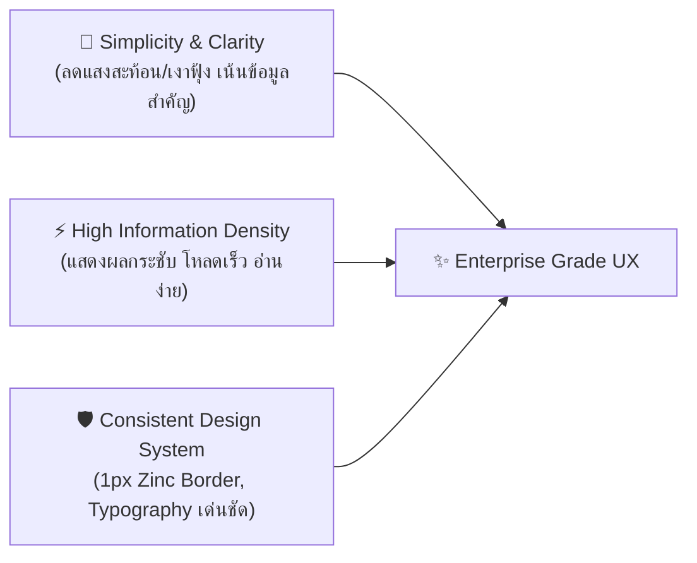
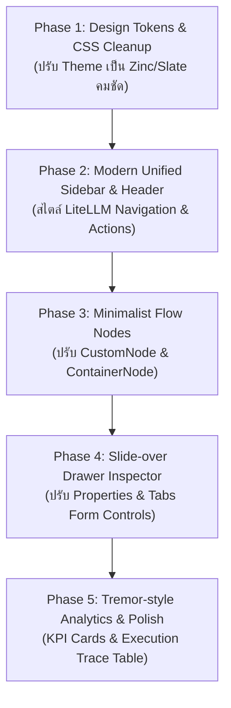

# 🎨 แผนแม่บทการปรับปรุง UX/UI สู่ "Builder Theme" (Official "Builder Theme" Modernization Plan)

> **เป้าหมาย:** ยกระดับประสบการณ์ผู้ใช้ (UX) และรูปลักษณ์หน้าตา (UI) ของ **AI Agent Visual Builder** สู่ดีไซน์ระบบมาตรฐานใหม่ในชื่อ **"Builder Theme"** ที่มีความสะอาดตา ทรงพลัง เรียบหรู ใช้งานง่าย และรองรับทั้ง Dark & Light Mode ตามแบบฉบับของ **LiteLLM Admin UI**, **shadcn/ui**, **Tremor**, และ **Vercel Enterprise**

---

## 1. ปรัชญาการออกแบบและวิสัยทัศน์ (Design Philosophy)

LiteLLM เป็นแพลตฟอร์มจัดการ AI โมเดลระดับองค์กรที่เป็นที่ยอมรับอย่างกว้างขวาง โดยมีหัวใจสำคัญของ UX/UI 3 ประการ:



| ปัจจัยการออกแบบ | รูปแบบเดิม (Current Legacy) | รูปแบบใหม่สไตล์ LiteLLM (Modern Target) |
| :--- | :--- | :--- |
| **Theme / Base** | มืดสนิท + แสงไฟนีออนฟ้า/ม่วง (Cyberpunk Glow) | **Zinc / Slate Dark Theme** (`#09090b`, `#18181b`) คมชัด เรียบหรู |
| **ขอบและเส้นแบ่ง** | ขอบมนหนา + เงาฟุ้งหลายชั้น (Clay/Drop shadow) | **Subtle 1px Borders** (`border-zinc-800`), เน้นความคมชัดระดับพิกเซล |
| **แถบนำทาง (Nav)** | ไอคอนลอยแยก 2 ราง และเมนู Flyout ซ้อนทับ | **Single Unified Left Sidebar** จัดหมวดหมู่ชัดเจน พร้อม Collapse Mode |
| **การ์ด Node บน Canvas** | กรอบกลมมนขนาดใหญ่ มีแสง Glow รอบตัว | **Minimalist Node Card** มี Header แบ่งประเภทชัดเจน, Status Pill เรียบหรู |
| **พาเนลตั้งค่า (Inspector)** | แถบลอยขนาดใหญ่ ปรับขนาดและเลื่อนยาก | **Right Slide-over Drawer** รองรับ Accordion + Tabs สะอาดตา |
| **หน้าจัดการโปรเจกต์** | การ์ดโฟลเดอร์สีสันฉูดฉาด | **Tremor-style Data Table & KPI Cards** แสดงสถิติการรัน อัตราความสำเร็จ และประวัติ |

---

## 2. ระบบสีและ Design Tokens ใหม่ (Design System)

### 2.1 Color Palette (Zinc Neutral + Modern AI Accents)
* **Background Primary:** `#09090b` (`zinc-950`) — พื้นหลัง Canvas และโครงสร้างหลัก
* **Background Secondary:** `#18181b` (`zinc-900`) — พื้นหลัง Sidebar, Header, Drawer, และ Card
* **Surface Hover / Active:** `#27272a` (`zinc-800`) — จุดที่เคอร์เซอร์ชี้หรือเมนูที่ถูกเลือก
* **Borders / Separators:** `#27272a` (`zinc-800`) และ `#3f3f46` (`zinc-700` เมื่อ Hover)
* **Text Primary:** `#f4f4f5` (`zinc-100`) — ข้อความหัวข้อและเนื้อหาหลัก
* **Text Secondary:** `#a1a1aa` (`zinc-400`) — คำอธิบายและ Sub-label
* **Text Muted:** `#71717a` (`zinc-500`) — ไอคอนรองและ Placeholder

### 2.2 Functional Accent Colors
* 🟢 **Success / Active / Healthy:** `emerald-500` (`#10b981`) — สถานะโมเดลพร้อมใช้งาน, Node ผ่านการทำงาน
* 🔵 **Primary Brand / Action:** `indigo-500` / `blue-500` (`#6366f1` / `#3b82f6`) — ปุ่ม Run, Connect, Highlight
* 🟡 **Warning / Pending:** `amber-500` (`#f59e0b`) — Waiting queue, Retry
* 🔴 **Error / Danger:** `rose-500` (`#f43f5e`) — Execution Failed, Delete Confirmation
* 🟣 **AI Specialists:** `violet-500` (`#8b5cf6`) — ป้ายกำกับตัวแทน AI Agent, LLM Model Prompt

### 2.3 ระบบสลับธีม Dark Mode / Light Mode (Dual-Theme Architecture สไตล์ LiteLLM)

ระบบรองรับการสลับระหว่าง **Dark Mode (Default)** และ **Light Mode** อย่างราบรื่น โดยอิงมาตรฐานของ **LiteLLM Dashboard (shadcn/ui & Tremor)**:

| องค์ประกอบ (Element) | ธีมมืด (LiteLLM Dark Zinc) | ธีมสว่าง (LiteLLM Light Neutral) |
| :--- | :--- | :--- |
| **Canvas Background** | `#09090b` (zinc-950) | `#fafafa` (zinc-50 / off-white คลีนตา) |
| **Canvas Dots Grid** | `#27272a` (zinc-800) | `#d4d4d8` (zinc-300 จุดละมุน 1.1px) |
| **Header & Sidebar** | `#121215` / `#101014` (border: `zinc-800`) | `#ffffff` (White, border: `#e4e4e7` zinc-200) |
| **Surface Card (Node)** | `#141418` (border: `zinc-800`) | `#ffffff` (border: `#e4e4e7`, shadow-xs 1px) |
| **Node Drag Header** | `#18181b` (zinc-900/60) | `#fafafa` (zinc-50, border: `#f4f4f5`) |
| **Connecting Edges** | `#3f3f46` (Idle), `#6366f1` (Running) | `#94a3b8` (Idle), `#4f46e5` (Running) |
| **Node Resizer Border** | `indigo-500` (High contrast) | `indigo-600` (Subtle 1px border) |
| **Primary Text** | `#f4f4f5` (zinc-100) | `#09090b` (zinc-950 เด่นชัด คมกริบ) |
| **Secondary Text** | `#a1a1aa` (zinc-400) | `#71717a` (zinc-500 อ่านง่าย สบายตา) |
| **Inspector Drawer** | `#121215` (border: `zinc-800`) | `#ffffff` (border: `#e4e4e7`, input: `#ffffff`) |
| **Logs Console Tray** | `#09090b` (Console dark) | `#ffffff` (Output: `#fafafa`, border: `#e4e4e7`) |
| **Analytics Cards** | `#121215` (Tremor Dark) | `#ffffff` (Tremor Light, shadow-xs) |

#### จุดควบคุมการสลับธีม (LiteLLM Minimalist ModeToggle):
1. **Top-Right Corner (ขวาสุดของจอ):** ปุ่มไอคอนมินิมอล `[ ☀️ / 🌙 ]` ขนาด `w-8 h-8 rounded-md` จัดวางอยู่ด้านขวาของปุ่ม **Save** แยกด้วยขีดแบ่ง 1px ตามแบบฉบับของ **LiteLLM Dashboard (shadcn/ui ModeToggle)**
2. **Keyboard Shortcut:** รองรับการกด `Ctrl + J` (หรือ `Cmd + J`) เพื่อสลับธีมได้ทันทีโดยไม่ต้องคลิกเมาส์
3. **State Persistence:** บันทึกค่าลง `localStorage` อัตโนมัติ (`ai_builder_theme: 'dark' | 'light'`) พร้อมรองรับค่าเริ่มต้นตาม `prefers-color-scheme`

--- | :--- | :--- |
| **Canvas Background** | `#09090b` (zinc-950) | `#f8fafc` (slate-50) |
| **Canvas Dots Grid** | `#27272a` (zinc-800) | `#cbd5e1` (slate-300) |
| **Header & Sidebar** | `#121215` / `#101014` | `#ffffff` (White, border: `#e2e8f0`) |
| **Surface Card (Node)** | `#141418` (border: `zinc-800`) | `#ffffff` (border: `#e2e8f0`, subtle shadow) |
| **Connecting Edges** | `#3f3f46` (Idle), `#6366f1` (Running) | `#94a3b8` (Idle), `#4f46e5` (Running) |
| **Node Resizer Border** | `indigo-500` (High contrast) | `indigo-600` (Subtle 1px border) |
| **Primary Text** | `#f4f4f5` (zinc-100) | `#0f172a` (slate-900) |
| **Secondary Text** | `#a1a1aa` (zinc-400) | `#64748b` (slate-500) |
| **Inspector Drawer** | `#121215` (border: `zinc-800`) | `#ffffff` (border: `#e2e8f0`) |
| **Logs Console Tray** | `#09090b` (Console dark) | `#ffffff` (Output: `#f8fafc`) |

#### จุดควบคุมการสลับธีม (Theme Controls):
1. **Top Contextual Header (Quick Toggle):** ปุ่มไอคอน ☀️ / 🌙 ด้านขวาของ Header เพื่อสลับโหมดได้ด้วยคลิกเดียว
2. **Left Unified Sidebar (Segmented Switch):** แผงปุ่มเลือก 2 ฝั่ง `[ ☀️ Light | 🌙 Dark ]` เหนือการ์ดโปรไฟล์ด้านล่างซ้าย
3. **Keyboard Shortcut:** รองรับการกด `Ctrl + J` (หรือ `Cmd + J`) เพื่อสลับธีมได้ทันที
4. **State Persistence:** บันทึกค่าลง `localStorage` อัตโนมัติ (`ai_builder_theme: 'dark' | 'light'`) พร้อมรองรับ `prefers-color-scheme` ของระบบปฏิบัติการ


---

## 3. สถาปัตยกรรมโครงสร้างหน้าจอ (Screen Layout & Modules)

```
+---------------------------------------------------------------------------------------------------------+
| [AI Builder]  Breadcrumb: Marketing Team / Data Ingestion Flow    (Saved)   [Validate] [Run Flow] [Save]|
+-----------+-------------------------------------------------------------------------------+-------------+
| 📊 Stats  |                                                                               |  PROPERTIES |
| 🔀 Canvas |                                                                               |  INSPECTOR  |
| 📁 Proj   |                                [ React Flow Canvas ]                          |             |
| 🤖 Models |                                                                               | [Tabs]      |
| 📦 Queues |       [Input Node] ---> [AI Agent Node] ---> [DuckDB Node] ---> [Export]      | - Config    |
| 📜 Logs   |                                                                               | - Params    |
| 👥 Users  |                                                                               | - Live I/O  |
| ⚙️ Settings|                                                                               | - Schema    |
|-----------|                                                                               |             |
| [User01]  | [Dock: Zoom / Auto-Layout / History / Mini-Map]                               | [Apply]     |
+-----------+-------------------------------------------------------------------------------+-------------+
| ⚡ Bottom Drawer: Live LangGraph Execution Traces & Console Logs (Collapsible / Fullscreen)             |
+---------------------------------------------------------------------------------------------------------+
```

### 3.1 แถบนำทางด้านซ้าย (Unified Left Sidebar & Collapsible Mode)
* **การออกแบบตามมาตรฐาน LiteLLM / shadcn UI Sidebar:**
  - **ระบบย่อ-ขยายแถบเมนู (Collapsible Sidebar):**
    - **Expanded Mode (ขนาดปกติ):** ความกว้าง `w-56` (224px) แสดงไอคอน, ป้ายชื่อเมนู (Nav Labels), หัวข้อหมวดหมู่ (Section Titles), และรายละเอียดผู้ใช้งาน
    - **Collapsed Mode (ขนาดย่อ):** ความกว้าง `w-16` (64px) ซ่อนข้อความทั้งหมดและจัดไอคอนให้อยู่กึ่งกลางอย่างสมมาตร พร้อมแสดง Tooltip ชัดเจนเมื่อ Hover เพื่อเพิ่มพื้นที่ทำงานให้ Canvas สูงสุด
    - **ปุ่มและคีย์ลัดสั่งย่อขยาย:**
      - ปุ่มไอคอน `PanelLeft` ข้างโลโก้แบรนด์ใน Top Header
      - ปุ่ม `Collapse Sidebar` ที่ส่วนล่างของแถบเมนู พร้อมไอคอน Chevron หมุนสลับทิศ
      - รองรับคีย์ลัด **`Ctrl + B`** (หรือ `Cmd + B`)
      - บันทึกสถานะการย่อ-ขยายลงใน `localStorage` (`ai_builder_sidebar_collapsed`)
  - **สไตล์ Active Menu คมเข้มชัดเจน (High-Contrast Active Item):**
    - **ใน Light Mode (สไตล์ LiteLLM):** ใช้พื้นหลังสีเทาอ่อน `#f4f4f5` (Zinc-100) ตัดกับเส้นขอบ `#e4e4e7` (Zinc-200) และตัวอักษรสีดำเข้มชัดเจน **`#09090b` (Zinc-950 Bold)** หมดปัญหาตัวหนังสือกลืนหรืออ่านยาก
    - **ใน Dark Mode:** ใช้พื้นหลังสี `rgba(99, 102, 241, 0.15)` ขอบ `rgba(99, 102, 241, 0.3)` และตัวอักษรสีขาวสว่าง `#ffffff` พร้อมไอคอนสี Indigo
  - **รายการเมนูหลัก (Icon + Clean Label):**
    1. **Overview / Analytics** (สถิติการรัน, Token Usage, Latency)
    2. **Canvas / Builder** (หน้าต่างออกแบบผังงานหลัก)
    3. **Workflows & Projects** (ระบบแฟ้มโปรเจกต์และผังงาน)
    4. **AI Models & Providers** (จัดการ Provider: Gemini, OpenAI, Claude, Ollama)
    5. **Queues & Lakehouse** (PDF Queue, Data Lake, Parquet/DuckDB tables)
    6. **Logs & Audit Traces** (ประวัติการรันและบันทึกกิจกรรมย้อนหลัง)
    7. **Access Control (RBAC)** (จัดการผู้ใช้งานและสิทธิ์ตามบทบาท)
    8. **Settings** (ตั้งค่า Canvas, Grid Snap, Auto-save)
  - **ด้านล่าง:** ข้อมูลโปรไฟล์ผู้ใช้และปุ่ม Sign out (ย่อเหลือเฉพาะรูป Avatar เมื่ออยู่ใน Collapsed Mode)

### 3.2 แถบควบคุมด้านบน (Contextual Header Bar)
* ออกแบบให้กระชับ มีพื้นที่แนวตั้งกว้างขึ้นสำหรับ Canvas:
  - **Breadcrumbs:** `Projects / Folder / Flow Name` (สามารถคลิกแก้ไขชื่อ Flow ได้แบบ Inline)
  - **Status Indicator:** จุดเขียวแสดงสถานะ Auto-saved หรือแจ้งเตือนเมื่อมี Unsaved changes
  - **Action Group:**
    - ปุ่ม **Arrangement / Clean Layout** (จัดระเบียบ Node อัตโนมัติ)
    - ปุ่ม **Validate Graph** (ตรวจเช็ค Cyclic Loop และ Broken Connection ก่อนรัน)
    - ปุ่ม **Run Flow** เด่นชัดด้วยสไตล์ Indigo/Emerald พร้อม Dropdown เลือกรันเฉพาะ Node ที่เลือก

### 3.3 การ์ด Node สไตล์ LiteLLM / Modern Minimalist
* ยกเลิกขอบนีออนฟุ้งและขอบการ์ดที่หนาเทอะทะ:
  - ใช้ **Header Bar** ที่ระบุประเภทของ Node ชัดเจน พร้อม Icon ขนาด 14px
  - มี **Type Badge** กระชับ เช่น `LLM AGENT`, `DATA CONNECTOR`, `EVALUATOR`
  - ส่วนเนื้อหาแสดงชื่อ Model ปัจจุบัน (เช่น `gemini-2.5-flash`), Input/Output summary
  - จุดเชื่อมต่อ (Handles) แบบเรียบหรู กึ่งโปร่งแสง และสว่างขึ้นเมื่อลากสายเข้าใกล้

### 3.4 ถาดดู Log ด้านล่าง (Bottom Log & Execution Tray)
* สไตล์ Developer Console แบบเดียวกับ Cloud IDE / LiteLLM Proxy Logs:
  - แท็บแยก: `All Logs`, `LangGraph Nodes`, `AI Responses`, `Errors`
  - มี Search Bar กรองข้อความ Log ได้ทันที
  - ปุ่ม Clear, Copy JSON, และขยายเต็มจอ (Expand Fullscreen)

---

## 4. แผนงานการดำเนินงาน 5 ระยะ (Step-by-Step Implementation Roadmap)



### 🔹 Phase 1: ปรับแต่ง Design Tokens และสไตล์ Tailwind (Foundation)
1. ปรับปรุง `frontend/src/index.css` เพื่อนำ Palette สี Zinc/Slate รองรับทั้ง Dark Mode และ Light Mode พร้อมระบบ 1px Border เข้ามาแทนที่เงาฟุ้งแบบเดิม
   - ติดตั้ง/กำหนด `ThemeProvider` (`dark` class บน `<html>`) รองรับการสลับธีมและจดจำค่าใน LocalStorage
2. สร้าง Class อรรถประโยชน์สำหรับการทำ Frosted Glass (`backdrop-blur-md bg-zinc-900/80`)
3. ทดสอบการ Build เพื่อให้แน่ใจว่าไม่มี CSS Breakage

### 🔹 Phase 2: รวมแถบนำทางเป็น Unified Sidebar & Contextual Header
1. ปรับปรุง `DashboardNavRail.tsx`, `CanvasNavRail.tsx`, และ `SubMenuFlyout.tsx` รวมเป็น `LiteLLMAppSidebar.tsx`
2. ปรับปรุง `CanvasHeader.tsx` ให้มี Breadcrumb, สถานะ Save, ปุ่มสลับ Dark/Light mode และกลุ่มปุ่มคำสั่งที่สะอาดตา
   - เพิ่ม Theme Toggle Segmented Control ในส่วนล่างของ `LiteLLMAppSidebar.tsx`
3. รองรับการย่อขยาย Sidebar (Expand / Collapse) อย่างนุ่มนวล

### 🔹 Phase 3: ยกเครื่องการ์ด Node บน Canvas (React Flow Nodes)
1. ปรับปรุง `CustomNode.tsx` และ `ContainerNode.tsx` ให้มีโครงสร้างเรียบหรูสไตล์การ์ด Modern Tool
2. เพิ่ม Status Pill ที่มุมการ์ด (เช่น `Idle`, `Running...`, `Completed`, `Failed`)
3. ปรับสไตล์สายเชื่อมต่อ (Edge) ให้เป็นเส้น Smooth Step สี Zinc-700 ที่ไฮไลท์เป็นสีเขียว/ฟ้าเมื่อข้อมูลไหลผ่าน

### 🔹 Phase 4: ปรับแต่ง Properties Inspector ให้เป็น Slide-over Drawer
1. ปรับ `PropertiesInspector.tsx` ให้เปิด-ปิดแบบ Smooth Slide-over จากขอบขวา
2. จัดแท็บการตั้งค่า: `Configuration`, `Model & Prompts`, `Data Schema`, `Node Output`
3. ใช้ฟอร์มคอนโทรลที่สะอาดตา สไตล์ Modern Web Form (Inter font, Zinc border, subtle focus ring)

### 🔹 Phase 5: ปรับหน้า Dashboard และ Log Console สไตล์ Tremor / LiteLLM
1. ปรับ `ProjectsDashboard.tsx` ให้มี Metric Stat Cards ด้านบน (Total Workflows, Active Runs, Success Rate)
2. ปรับปรุงตารางรายชื่อ Workflow ให้ค้นหาได้ง่าย มีปุ่ม Actions Menu (`...`) กระชับ
3. ปรับ `BottomLogViewerTray.tsx` ให้เป็น Console ล้ำสมัย รองรับการดูสตรีมมิ่ง Token

---

## 5. การรับประกันความปลอดภัยและการทำงานต่อเนื่อง (Safety Assurances)

> [!IMPORTANT]
> **หลักการ Zero Business-Logic Breakage:**
> 1. **ไม่แตะต้อง State หรือ Data Schema:** ข้อมูล Node, Edges, Workflow JSON และการเชื่อมโยง Backend ยังคงใช้โครงสร้างเดิม 100%
> 2. **ไม่กระทบ LangGraph Execution:** API Communication (`/api/workflows/run`, `/api/sse/progress`) ยังคงส่งและรับ Payload ในรูปแบบเดิม
> 3. **รักษามาตรฐานการทดสอบ:** ทุก Phase จะต้องผ่านการตรวจ `tsc`, `npm run build` และ `pytest` ทั้ง 24 ตัวก่อนทุกครั้ง

